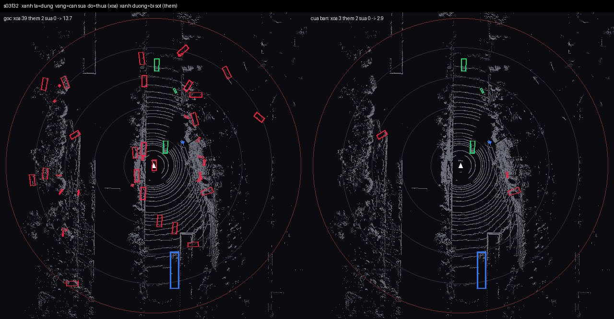

# Báo cáo Day 14 — Nguyễn Chí Tài — 2A202603223

- Mã học viên dùng với `--student`: `223`
- `seed_tag` trong `frames_A.txt`: `393590736f`

## 1. Dự đoán trước sweep (bước 5b)

- Tham số tôi nghĩ giảm công sửa nhiều nhất: Tăng `score_thr` (từ `0.1` lên khoảng `0.35`).
- Vì sao (nhìn ảnh BEV tập A: box thừa nhiều hay box sót nhiều?): Ở 3 frame tập A, số hộp thừa phải xóa áp đảo (`xóa = 81` chiếm `24.3/30.8` điểm chi phí, so với `thêm = 5` và `sửa = 3`). Khi tự kiểm trên CVAT, phần lớn hộp thừa là hộp nhiễu có độ tin cậy (`score`) thấp nên tăng `score_thr` lên khoảng `0.35` kỳ vọng sẽ lọc bớt nhiều hộp thừa mà không làm tăng mạnh số hộp bị sót.

## 2. Tập A: sửa tay và tune

| Cấu hình | Xóa | Thêm | Sửa | Chi phí |
|---|---:|---:|---:|---:|
| Gốc | 81 | 5 | 3 | 30.8 |
| `best_config.json` | 5 | 10 | 2 | 12.5 |

- Tham số đã đổi trong `best_config.json`: `score_thr: 0.1 -> 0.5` (giữ `min_points = 0`).
- Kết quả leave-one-out (dán các dòng `scripts/pp_sweep.py` in ra):
  ```text
  Leave-one-out (chọn trên các frame còn lại, chấm trên frame bỏ ra):
    s01f34: cấu hình chọn {'score_thr': '0.5', 'min_points': '0'} → 6.1 (tốt nhất có thể 6.1)
    s03f32: cấu hình chọn {'score_thr': '0.5', 'min_points': '0'} → 2.9 (tốt nhất có thể 2.9)
    s04f49: cấu hình chọn {'score_thr': '0.5', 'min_points': '0'} → 3.5 (tốt nhất có thể 2.1)
  ```
- Cấu hình có ổn định trên từng frame không? Vì sao tôi vẫn chọn (hoặc không chọn) nó: Cấu hình ổn định trên cả 3 lượt leave-one-out (cả 3 fold đều chọn cùng `score_thr=0.5, min_points=0`), đạt đúng mức oracle ở `s01f34` (6.1/6.1) và `s03f32` (2.9/2.9), chỉ chênh 1.4 điểm so với oracle ở `s04f49` (3.5 so với 2.1). Dù tăng `score_thr` lên `0.5` làm tăng hộp bị sót từ `5` lên `10`, số hộp thừa phải xóa giảm mạnh từ `81` xuống `5` nên tổng chi phí giảm từ `30.8` xuống `12.5`. Vì vậy tôi chọn `best_config.json` để áp dụng cho tập B.

## 3. Trước/sau (bước 8)



- `scripts/pp_compare.py` báo giảm **59%** công sửa trên tập A (`30.8 -> 12.5`: `s01f34` `12.3 -> 6.1`, `s03f32` `13.7 -> 2.9`, `s04f49` `4.8 -> 3.5`).
- Dự đoán ở mục 1 đúng hay sai? Giải thích bằng số box xóa/thêm/sửa: Dự đoán ở mục 1 **đúng về hướng và tham số chính** (`score_thr` là tham số giảm công sửa nhiều nhất, còn `min_points` hầu như không cải thiện thêm khi `score_thr=0.5`), nhưng **chưa đúng về mức ngưỡng tối ưu** (thực tế tốt nhất ở `0.5` thay vì dự đoán `0.35`). Cụ thể, khi tăng `score_thr` từ `0.1` lên `0.5`, số hộp thừa phải xóa giảm mạnh từ `81` xuống `5` (giảm `22.8` điểm chi phí) và số hộp phải sửa giảm từ `3` xuống `2` (giảm `0.5` điểm), lớn hơn nhiều so với phần chi phí tăng thêm do hộp bị sót tăng từ `5` lên `10` (tăng `5.0` điểm), nên tổng chi phí giảm từ `30.8` xuống `12.5` (giảm `59%`).

## 4. Tập B

Số đo từ `scripts/pp_prelabel.py --frames d14_223/frames_B.txt --config d14_223/best_config.json --gt d14_223/ref_B.json`:

| Xóa | Thêm | Sửa | Chi phí |
|---:|---:|---:|---:|
| 21 | 30 | 8 | 40.3 |

- Loại box tốn công sửa nhất ở tập B: **Box bị sót phải vẽ thêm (`thêm = 30`, chiếm `30.0 / 40.3` điểm chi phí)**, tiếp đến là box thừa (`xóa = 21`, `6.3` điểm) và box cần chỉnh (`sửa = 8`, `4.0` điểm). Theo phân bố lớp giữa `pred_B.json` (`Car: 125, Cyclist: 18, Pedestrian: 2`) và `ref_B.json` (`Car: 126, Cyclist: 15, Pedestrian: 9, Truck: 5, Bus: 1`), các vật thể nhỏ ở xa (`Pedestrian`) và xe cỡ lớn chưa có trong trọng số KITTI (`Truck`, `Bus`) bị bỏ sót hoặc gán nhầm lớp nhiều nhất; ngoài ra mức `score_thr = 0.5` tune từ 3 frame tập A khá gắt nên lọc mất một phần vật thật trên 12 frame tập B.

## 5. Giới hạn

- **Tập tune quá nhỏ (chỉ 3 frame tập A):** Dễ thiên lệch theo phân bố nhiễu của 3 frame tập A (tập A có tới 81 box thừa nên sweep đẩy `score_thr` lên `0.5`; khi mang sang 12 frame tập B thì số box bị sót `thêm = 30` lại trở thành nguồn chi phí chính).
- **Lệch miền dữ liệu và tập lớp giữa KITTI và VF:** Weights PointPillars huấn luyện trên KITTI chỉ có 3 lớp (`Car`, `Cyclist`, `Pedestrian`) và không được huấn luyện cho `Truck`, `Bus` cũng như đặc trưng LiDAR 360° của VF nên dễ sót hoặc nhận nhầm xe lớn/người đi bộ ở xa.
- **Công thức `correction_cost` chỉ là trọng số quy ước (`0.3·xóa + 1.0·thêm + 0.5·sửa`):** Chưa phản ánh thời gian hay số thao tác sửa thực tế của từng người trên CVAT (ví dụ vẽ một xe buýt dài hay chỉnh hộp ở xa thưa điểm tốn công khác nhau), nên không thể suy ra trực tiếp thành "tiết kiệm X giờ công".
